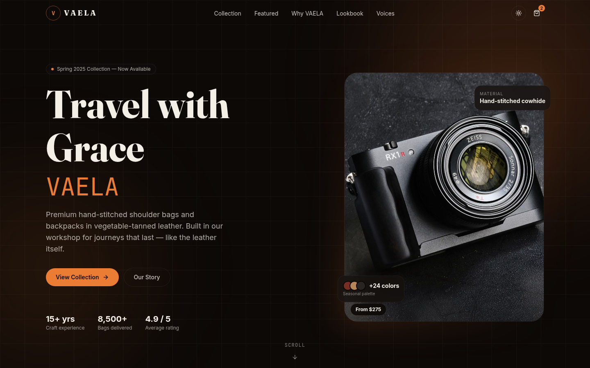
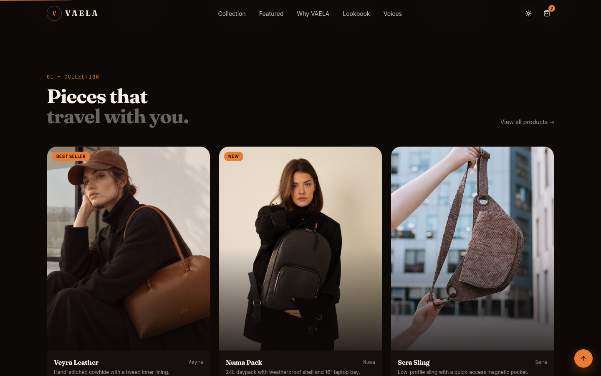
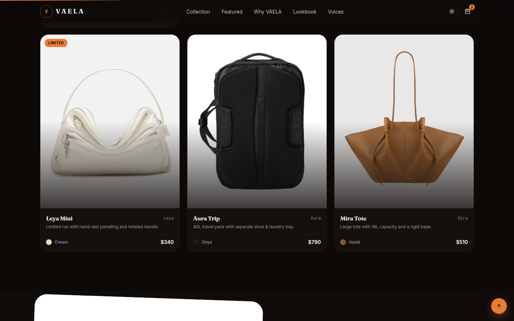
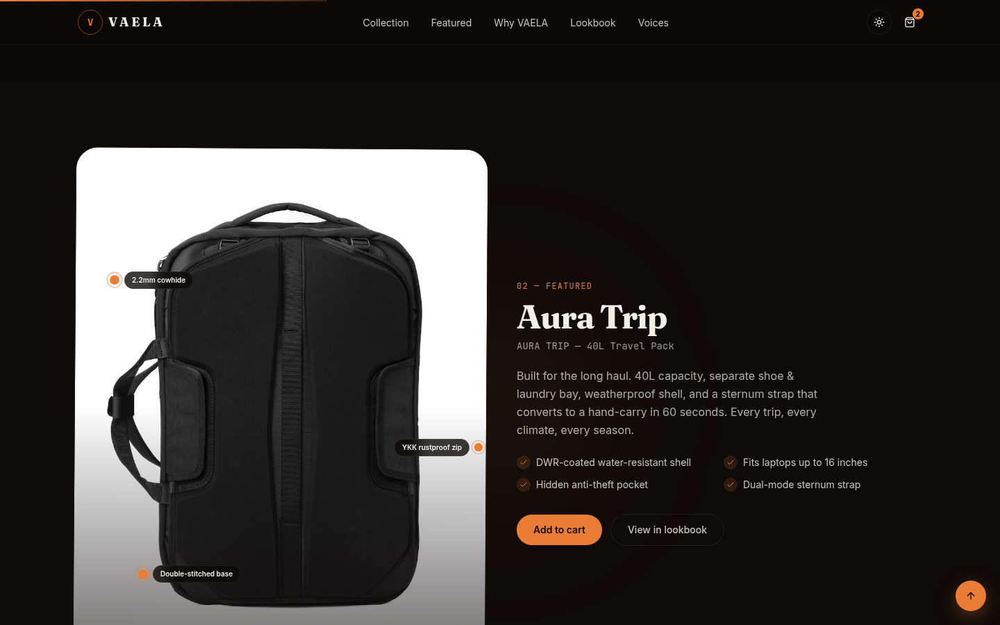
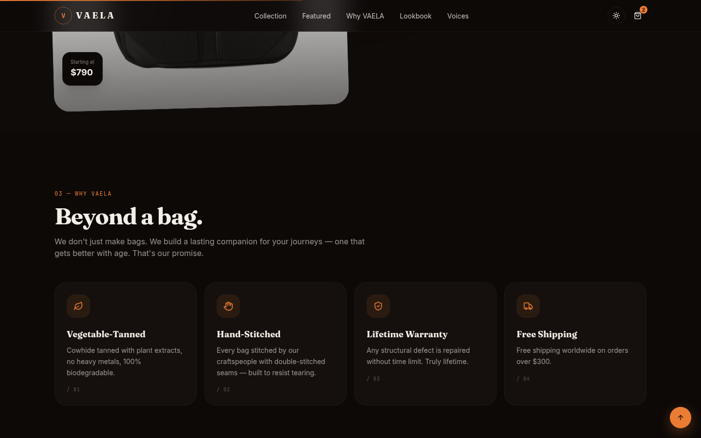
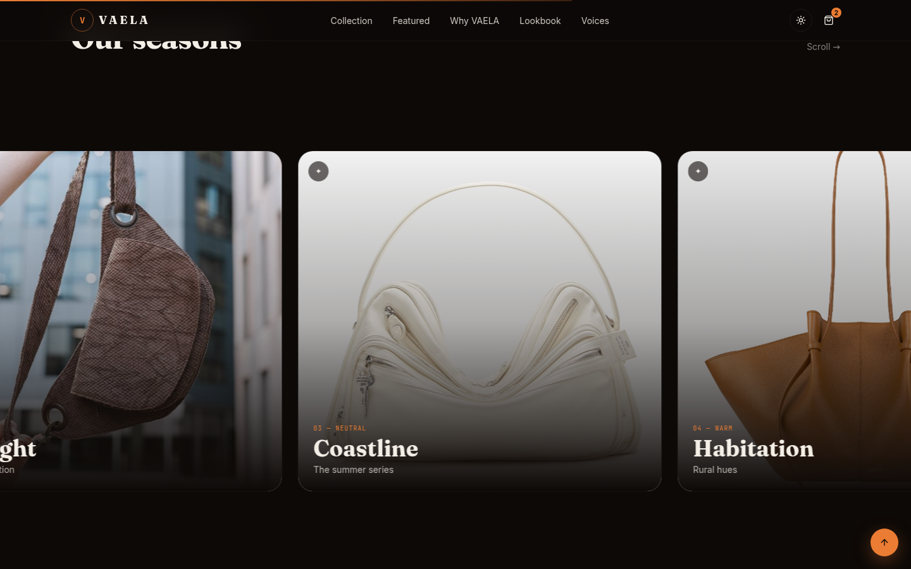
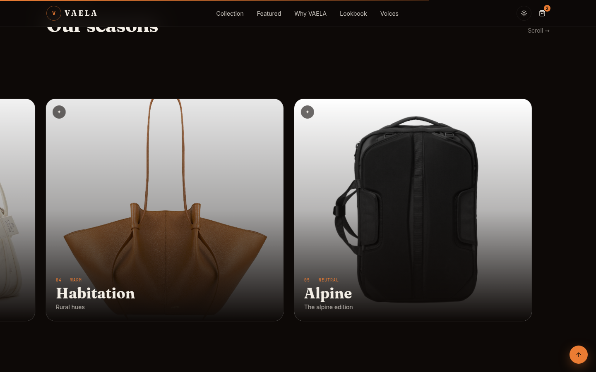

<div dir="rtl" align="right">

<div align="center">

# VAELA — سفر با وقار

**سایت پریمیوم برند کوله و کیف دوشی — دست‌دوز با چرم دباغی‌شده با گیاه**

[](https://amiralisite.github.io/vaela/)
[](https://github.com/amiraliSite/vaela)
[](https://nextjs.org/)
[](https://www.typescriptlang.org/)
[](https://tailwindcss.com/)

</div>

---

## درباره پروژه

این پروژه یه **سایت تک‌صفحه‌ای marketing** برند خیالی «VAELA» هست — یه برند پریمیوم کوله و کیف دوشی چرمی. هدف اصلی پروژه نشون‌دادن مهارت در **طراحی تجسمی، انیمیشن اسکرول، و تایپوگرافی ادیتوریال** هست.

> 💡 سایت کاملاً **responsive** (موبایل/تبلت/دسکتاپ)، با تم تاریک/روشن قابل تغییر، و **بدون بک‌اند** کار می‌کنه. تمام داده‌ها در `src/lib/data.ts` به‌صورت static تعریف شدن.

**ویژگی‌های اصلی:**

- ✨ **انیمیشن‌های Framer Motion**: رفع حرف‌به‌حرف، پارالاکس اسکرول، 3D-tilt کارت‌ها، scroll-staggered reveal
- 🎨 **تم تاریک «چرمی»**: پالت کهربایی/نارنجی سوخته با پشت‌زمینه‌ی مشکی گرم
- 🔤 **تایپوگرافی خارجی**: Fraunces (display serif)، Inter (body)، JetBrains Mono (accents) — لود شده از Google Fonts CDN
- 🖼️ **عکس‌های Iran-friendly**: همه‌ی عکس‌ها از CDN چینی (`z-cdn.chatglm.cn`) سرو می‌شن که **بدون فیلترشکن در ایران قابل دسترسی** هست
- 📦 **Static export** برای GitHub Pages با basePath خودکار
- ♿ **Accessibility**: semantic HTML، ARIA labels، keyboard navigation

---

## اسکرین‌شات‌ها

### ۱. بخش هیرو (Hero)



صفحه‌ی اول — عنوان «Travel with Grace» با انیمیشن letter-by-letter reveal ظاهر می‌شه. تصویر محصول به‌صورت پارالاکس با اسکرول حرکت می‌کنه و سه floating chip (جنس، پالت رنگ، قیمت) دور تصویر شناور هستن. در پایین، یه indicator عمودی برای «Scroll» با یه پیکان چشمک‌زن.

### ۲. کالکشن محصولات (Collection)



شش محصول در یه grid ۳-ستونی. هر کارت با حرکت موس به‌صورت ۳D tilt می‌چرخه، تصویر در hover zoom می‌شه، و یه دکمه‌ی شناور «+» برای افزودن به سبد ظاهر می‌شه. هر محصول اسم، رنگ، توضیح کوتاه، قیمت، و یه tag (Best Seller / New / Limited) داره.

### ۳. محصول ویژه (Spotlight — Aura Trip)



بخش ویژه برای محصول Aura Trip 40L. تصویر با اسکرول پارالاکس می‌چرخه و سه annotation پالس‌دار دورش قرار دارن (چرم ۲.۲ میلی‌متری، زیپ YKK، دوخت دوگانه). در سمت چپ، توضیح کامل + ۴ spec کلیدی + دکمه‌های CTA.

### ۴. ویژگی‌ها (Why VAELA)



چهار ستون برند: چرم دباغی‌شده با گیاه، دست‌دوز اصیل، گارانش مادام‌العمر، ارسال رایگان. هر کارت با scroll-reveal انیمیشن‌دار ظاهر می‌شه و در hover یه glow گرم در گوشه‌ی بالا‌راست روشن می‌شه.

### ۵. لوک‌بوک (Lookbook)



گالری با اسکرول افقی **پارالاکس** — وقتی کاربر به‌صورت عمودی اسکرول می‌کنه، محتوای افقی به‌صورت horizontal pan حرکت می‌کنه. هر کارت یه عنوان فصلی (Desert Bloom، Midnight، Coastline، ...) داره و در hover scale می‌شه.

### ۶. تجربه‌ها (Testimonials)



کاروسل با autoplay هر ۷ ثانیه. هر نظر شامل ۵ ستاره، نقل قول، آواتار، اسم و نقش. دکمه‌های قبلی/بعدی + dots برای navigation مستقیم.

### ۷. خبرنامه (Newsletter CTA)



بخش فرم خبرنامه با یه پشت‌زمینه‌ی gradient گرم + glow های شناور. فرم با toast موفقیت کار می‌کنه (به‌صورت دستی بدون backend — فقط یه simulated submit). سه badge پایین (No spam، Unsubscribe anytime، ۱۲٬۴۰۰ عضو فعال).

---

## تکنولوژی‌ها

| لایه | تکنولوژی |
|------|----------|
| فریم‌ورک | Next.js 16 (App Router، Turbopack) |
| زبان | TypeScript 5 (strict) |
| استایل | Tailwind CSS 4 با CSS variables سفارشی |
| انیمیشن | Framer Motion 12 |
| تم | `next-themes` (dark/light) |
| Toast | `sonner` |
| آیکون | `lucide-react` |
| UI پایه | `shadcn/ui` (New York) |
| تایپوگرافی | Fraunces + Inter + JetBrains Mono (Google Fonts CDN) |

---

## ساختار پروژه

```
src/
├─ app/
│  ├─ layout.tsx        # فونت‌ها، metadata، theme provider
│  ├─ page.tsx          # تمام بخش‌ها رو compose می‌کنه
│  └─ globals.css       # تم «چرمی» با CSS variables
├─ components/
│  ├─ site/             # تمام بخش‌های VAELA
│  │  ├─ navbar.tsx          # هدر شفاف → solid در اسکرول
│  │  ├─ hero.tsx            # هیرو با letter reveal + پارالاکس
│  │  ├─ marquee.tsx         # نوار متنی متحرک
│  │  ├─ collection.tsx      # ۶ محصول با 3D-tilt
│  │  ├─ spotlight.tsx      # محصول ویژه با annotations
│  │  ├─ features.tsx        # ۴ ستون برند
│  │  ├─ lookbook.tsx        # گالری اسکرول افقی
│  │  ├─ testimonials.tsx    # کاروسل
│  │  ├─ cta.tsx             # فرم خبرنامه
│  │  ├─ footer.tsx          # فوتر + wordmark بزرگ
│  │  ├─ theme-provider.tsx  # wrapper برای next-themes
│  │  ├─ theme-toggle.tsx    # دکمه تغییر تم
│  │  ├─ scroll-progress.tsx # نوار پیشرفت بالای صفحه
│  │  ├─ cursor-glow.tsx     # هاله‌ی موس (desktop)
│  │  └─ back-to-top.tsx     # دکمه شناور برگشت به بالا
│  └─ ui/               # کامپوننت‌های shadcn/ui
└─ lib/
   ├─ data.ts           # محصولات، testimonials، lookbook، features
   └─ utils.ts
```

---

## شروع به کار

### پیش‌نیازها

- [Bun](https://bun.sh/) (یا npm/yarn/pnpm)
- Node.js 18+

### نصب و اجرا

```bash
# کلون ریپو
git clone https://github.com/amiraliSite/vaela.git
cd vaela

# نصب وابستگی‌ها
bun install

# اجرای dev server (روی http://localhost:3000)
bun run dev
```

### build برای GitHub Pages

این پروژه از یه **env-aware config** استفاده می‌کنه:

- بدون env: `bun run build` → خروجی standalone (برای dev sandbox)
- با `GH_PAGES=true`: `bun run build` → خروجی static export با basePath `/vaela` (برای GitHub Pages)

برای deploy به Pages:

```bash
# ۱. build با flag
GH_PAGES=true bun run build

# ۲. محتوای out/ رو در یه orphan branch به اسم gh-pages کپی کن
# ۳. فایل .nojekyll خالی بساز (مهم! بدون این، _next/ سرو نمی‌شه)
# ۴. push به origin gh-pages
```

> **نکته**: اگه پروژه‌ت رو به یه اسم دیگه deploy می‌کنی، باید `basePath` و `assetPrefix` در `next.config.ts` رو هم عوض کنی (مثلاً `/{repo-name}`).

---

## سفارشی‌سازی

### تغییر محصولات

همه‌ی محصولات در `src/lib/data.ts` تعریف شدن. برای اضافه/حذف/تغییر محصول، فقط اون فایل رو ویرایش کن:

```ts
export const products: Product[] = [
  {
    id: "v-001",
    name: "Veyra Leather",
    category: "Shoulder",
    price: 480,
    color: "Oxblood",
    hex: "#7a2f24",
    image: "URL-عکس-اینجا",
    tag: "Best Seller",
    blurb: "توضیح کوتاه محصول",
  },
  // ...
]
```

### تغییر رنگ‌های تم

پالت رنگ در `src/app/globals.css` به‌صورت CSS variables تعریف شده. فقط مقادیر `--accent`، `--background`، `--foreground` رو عوض کن:

```css
:root {
  --accent: oklch(0.65 0.14 50);     /* رنگ تاکستیل/کهربایی */
  --background: oklch(0.985 0.008 75); /* کرم گرم */
  --foreground: oklch(0.18 0.012 50);  /* قهوه‌ای تیره */
}
```

### عوض‌کردن عکس‌ها

عکس‌ها از CDN چینی (`z-cdn.chatglm.cn`) سرو می‌شن که **بدون فیلترشکن در ایران قابل دسترسی** هست. اگه خواستی عکس‌ها رو عوض کنی، می‌تونی URL هر عکس رو با هر URL دیگه‌ای (مثلاً عکس‌های آپلود شده‌ی خودت) در `src/lib/data.ts` و `src/components/site/hero.tsx` و `src/components/site/spotlight.tsx` عوض کنی.

---

## لینک‌ها

- 🌐 **سایت زنده**: https://amiralisite.github.io/vaela/
- 📦 **ریپو گیت‌هاب**: https://github.com/amiraliSite/vaela
- 💬 **ریپو Issues**: https://github.com/amiraliSite/vaela/issues

---

## لایسنس

MIT — این پروژه به‌عنوان نمونه‌کار ساخته شده. استفاده‌ی آزاد.

---

</div>

<div dir="ltr" align="left">

## English Summary

VAELA is a single-page marketing site for a fictional premium leather bag brand. Built with Next.js 16 + TypeScript + Tailwind 4 + Framer Motion. Key features: scroll-driven parallax, letter-by-letter headline reveal, 3D-tilt product cards, sticky horizontal-pan lookbook, autoplay testimonials, dark/light theme, and Iran-friendly CDN-hosted images (no VPN needed). Deployed to GitHub Pages via static export with auto basePath. **[Live →](https://amiralisite.github.io/vaela/)**

</div>
